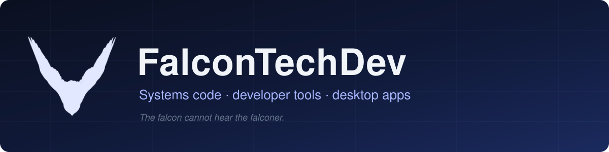

Built from the lowest layer that makes the problem honest: kernel accounting instead of sampling, measured results instead of claims, one binary instead of a stack.

## Flagship

<table>
<tr>
<td width="50%" valign="top">

### [FalconDB](https://github.com/FalconTechDev/falcondb) &nbsp;`Rust`
A columnar analytical database engine written from scratch: storage, encodings, planner, executor, indices, WAL and the SQL front end. Benchmarked against DuckDB, DataFusion and Polars, with the method and numbers in the repository.

</td>
<td width="50%" valign="top">

### [netwatch](https://github.com/FalconTechDev/netwatch) &nbsp;`Rust`
Which program is using your connection, and how much. Reads the kernel's own accounting (ETW on Windows, eBPF on Linux) instead of sampling.

</td>
</tr>
<tr>
<td width="50%" valign="top">

###  [synchronize](https://github.com/FalconTechDev/synchronize) &nbsp;`Go`
Keeps every git repository in step across every machine you work on: sync at login, on a timer and before shutdown. Windows, Linux and macOS builds in [Releases](https://github.com/FalconTechDev/synchronize/releases).

</td>
<td width="50%" valign="top">

### [falconnet](https://github.com/FalconTechDev/falconnet) &nbsp;`Rust`
SQL, diagnostics and per-process attribution over packet captures: Wireshark that answers questions.

</td>
</tr>
</table>

## Developer tools

Small tools that each answer one question, with measured results.

| Tool | What it answers |
|---|---|
| [**sql-traps**](https://github.com/FalconTechDev/sql-traps) | The same SQL on MySQL, MariaDB, PostgreSQL and SQL Server in Docker: where the results differ, with versions and dates. |
| [**workflow-doctor**](https://github.com/FalconTechDev/workflow-doctor) | Where a GitHub Actions workflow loses minutes: per step, retries, cache, critical path, cost. |
| [**flakemap-contrib**](https://github.com/FalconTechDev/flakemap-contrib) | Which new or changed pytest tests are unstable: rerun N times and fail on mixed results. |
| [**jest-polluter-finder**](https://github.com/FalconTechDev/jest-polluter-finder) | Which Jest test files make a victim test fail, found by delta debugging. |
| [**dockerfile-diff-size**](https://github.com/FalconTechDev/dockerfile-diff-size) | Which Dockerfile instruction made the image bigger, layer by layer. |

## Desktop apps

<table>
<tr>
<td width="33%" valign="top">

###  [vk-chain](https://github.com/FalconTechDev/vk-chain)
Chain-of-handshakes finder and interactive friend-network explorer for VKontakte.

</td>
<td width="33%" valign="top">

### [mini-player](https://github.com/FalconTechDev/mini-player)
Floating always-on-top mini windows for YouTube, TikTok, Twitch and video files.

</td>
<td width="33%" valign="top">

### [desktop-focus](https://github.com/FalconTechDev/desktop-focus)
Hide every desktop icon except the ones you choose, and restore their positions.

</td>
</tr>
</table>

---

Each project has its own README with install steps, limits and how it was measured. Issues and pull requests are welcome.

