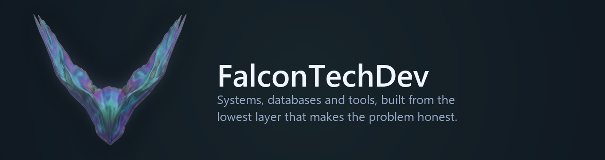

Built from the lowest layer that makes the problem honest: kernel accounting instead of sampling, measured results instead of claims, one binary instead of a stack.

Every repository says how it was measured and where it loses. A number without the conditions it was taken under is not a result.

## Flagship

<table>
<tr>
<td width="50%" valign="top">

### [FalconDB](https://github.com/FalconTechDev/falcondb) &nbsp;`Rust`
A columnar analytical database engine written from scratch: storage, encodings, planner, executor, indices, WAL and the SQL front end. Benchmarked in one process against DuckDB, DataFusion and Polars over the same Parquet file — ahead of DuckDB and DataFusion on all 26 measured points — with the method, the drift and the places it trails in the repository.

</td>
<td width="50%" valign="top">

### [netwatch](https://github.com/FalconTechDev/netwatch) &nbsp;`Rust`
Which program is using your connection, and how much. Reads the kernel's own accounting — ETW on Windows, eBPF on Linux — instead of sampling, so a short-lived process is not missed between two polls.

</td>
</tr>
<tr>
<td width="50%" valign="top">

### [sotto](https://github.com/FalconTechDev/sotto) &nbsp;`Rust`
End-to-end encrypted secret sync for developer teams. Encryption happens locally; the server only ever stores ciphertext and never holds a key that could decrypt it.

</td>
<td width="50%" valign="top">

### [falconnet](https://github.com/FalconTechDev/falconnet) &nbsp;`Rust`
SQL, diagnostics and per-process attribution over packet captures: Wireshark that answers questions rather than showing frames.

</td>
</tr>
<tr>
<td width="50%" valign="top">

###  [synchronize](https://github.com/FalconTechDev/synchronize) &nbsp;`Go`
Keeps every git repository in step across every machine you work on: at login, on a timer, and before shutdown. Windows, Linux and macOS builds in [Releases](https://github.com/FalconTechDev/synchronize/releases).

</td>
<td width="50%" valign="top">

### [help-finder](https://github.com/FalconTechDev/help-finder) &nbsp;`Python`
A read-only scan for questions nobody has answered yet, across GitHub, Stack Overflow, Hacker News, Habr, dev.to, Lobsters and Discourse.

</td>
</tr>
</table>

## Developer tools

Small tools that each answer one question, with measured results.

| Tool | What it answers |
|---|---|
| [**sql-traps**](https://github.com/FalconTechDev/sql-traps) | The same SQL on MySQL, MariaDB, PostgreSQL and SQL Server in Docker: where the results differ, with versions and dates. |
| [**workflow-doctor**](https://github.com/FalconTechDev/workflow-doctor) | Where a GitHub Actions workflow loses minutes: per step, retries, cache, critical path, cost. |
| [**flakemap-contrib**](https://github.com/FalconTechDev/flakemap-contrib) | Which new or changed pytest tests are unstable: rerun N times and fail on mixed results. |
| [**jest-polluter-finder**](https://github.com/FalconTechDev/jest-polluter-finder) | Which Jest test files make a victim test fail, found by delta debugging. |
| [**dockerfile-diff-size**](https://github.com/FalconTechDev/dockerfile-diff-size) | Which Dockerfile instruction made the image bigger, layer by layer. |

## Desktop apps

<table>
<tr>
<td width="33%" valign="top">

###  [vk-chain](https://github.com/FalconTechDev/vk-chain)
Chain-of-handshakes finder and interactive friend-network explorer for VKontakte.

</td>
<td width="33%" valign="top">

###  [mini-player](https://github.com/FalconTechDev/mini-player)
Floating always-on-top mini windows for YouTube, TikTok, Twitch and video files.

</td>
<td width="33%" valign="top">

### [desktop-focus](https://github.com/FalconTechDev/desktop-focus)
Hide every desktop icon except the ones you choose, and restore their positions.

</td>
</tr>
</table>

---

Each project has its own README with install steps, limits, and how it was measured. 
Issues and pull requests are welcome.

